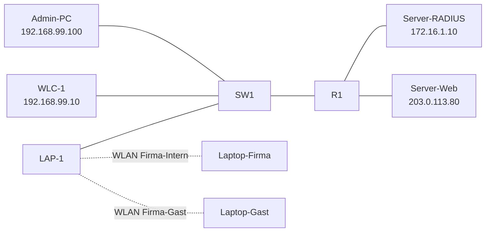

# 01.1 WLAN für Firma und Gäste in Packet Tracer

| | |
|---|---|
| **Modul** | 01 Packet Tracer |
| **Stufe** | Aufbau |
| **Geschätzte Zeit** | 2 bis 3 Stunden (Schätzung) |
| **Werkzeug** | Cisco Packet Tracer (Router, Switch, Wireless LAN Controller, Lightweight Access Point, Server, Laptops) |
| **Vorwissen** | VLANs, Trunks, Router-on-a-Stick, DHCP-Pools und ACLs auf Cisco IOS (Grundlagen genügen) |

> [!WARNING]
> **Stand der Prüfung: Entwurf.** Packet Tracer wurde **nicht** ausgeführt. Alle Menüs und Ausgaben stammen aus offiziellen Cisco-Übungen und einem Tutorial (siehe Quellen) und sind sinngemäß. Der **Wireless LAN Controller (WLC)** hat in Packet Tracer nach den Quellen **nur eine Weboberfläche**, keine Befehlszeile. Dort steht bei jedem Schritt „nur grafisch“. Die erste Einrichtung des WLC (Management-Adresse, Administratorkonto) ist in den Quellen nicht genau beschrieben und mit *nicht bestätigt* markiert. Bitte nachbauen und Abweichungen melden.

## Lernziele

Nach dieser Übung kannst du

- erklären, warum ein Firmen-WLAN und ein Gäste-WLAN auf getrennten VLANs liegen müssen und nicht nur zwei Namen auf einem Netz sind,
- einen Switchport zum Access Point und zum Controller als Trunk einrichten,
- am WLC zwei WLANs anlegen: eines mit Anmeldung über Benutzername und Kennwort (WPA2-Enterprise, RADIUS), eines mit gemeinsamem Kennwort (WPA2-PSK) für Gäste,
- auf dem Router mit einer erweiterten ACL festlegen, was das Gäste-VLAN erreichen darf,
- mit Tests nachweisen, dass Gäste das Firmennetz nicht erreichen,
- erklären, was Packet Tracer an dieser Stelle **nicht** nachbilden kann (Client-Isolation, Bandbreitenbegrenzung, Anmeldeportal).

## Voraussetzungen

- Packet Tracer mit Wireless-Geräten (WLC und Lightweight AP). Die Gerätenamen unterscheiden sich je nach Version. Gesucht sind ein **Wireless LAN Controller** und ein **Lightweight Access Point**.
- Du kennst die IOS-Befehle für VLANs, Trunks und Subinterfaces (Übungen in Modul 2 und 3 der Netzwerk-Reihe oder vergleichbar).
- Du baust die `.pkt`-Datei selbst. Dieses Dokument beschreibt Topologie und Schritte.

## Grundbegriffe

| Begriff | Bedeutung |
|---|---|
| **SSID** | Der sichtbare Name eines WLANs. Eine SSID ist nur ein Name, sie trennt nichts. Getrennt wird erst durch das **VLAN**, das an der SSID hängt. |
| **WLC** | Wireless LAN Controller. Zentrale Verwaltung aller Access Points. Hier legst du WLANs an. |
| **LAP** | Lightweight Access Point. Funkt, wird aber vom WLC konfiguriert und macht allein nichts. |
| **WPA2-Personal (PSK)** | Alle teilen sich ein Kennwort. Für Gäste üblich. |
| **WPA2-Enterprise (802.1X)** | Jeder meldet sich mit eigenem Konto an. Ein RADIUS-Server prüft die Anmeldung. |
| **RADIUS** | Protokoll, mit dem Access Point oder Controller beim Server nachfragt, ob ein Benutzer zugelassen wird. |
| **Dynamische Schnittstelle** | Im WLC eine Schnittstelle je VLAN, auf der die Clients einer SSID ins Netz gelangen. |
| **Trunk** | Switchverbindung, die mehrere VLANs mit Markierung (Tag) überträgt. |
| **ACL (extended)** | Filterliste auf dem Router. Erweitert: prüft Quelle, Ziel, Protokoll und Port. |

## Topologie und Adressplan

Die Adressen sind frei gewählt und privat bzw. aus dem für Dokumentation reservierten Bereich `203.0.113.0/24`.

<!-- tikz:topologie -->


| VLAN | Name | Netz | Router (Gateway) | Zweck |
|---|---|---|---|---|
| 10 | FIRMA | 192.168.10.0/24 | 192.168.10.1 | Clients des Firmen-WLAN |
| 20 | GAST | 192.168.20.0/24 | 192.168.20.1 | Clients des Gäste-WLAN |
| 99 | MGMT | 192.168.99.0/24 | 192.168.99.1 | Verwaltung von Switch, WLC, Access Point |
| – | Server | 172.16.1.0/24 | 172.16.1.1 (Gi0/1) | RADIUS-Server |
| – | „Internet“ | 203.0.113.0/24 | 203.0.113.1 (Gi0/2) | Web-Server als Stellvertreter für das Internet |

| Gerät | Schnittstelle | Adresse | Anmerkung |
|---|---|---|---|
| R1 | Gi0/0 | – | Trunk zu SW1, Subinterfaces .10, .20, .99 |
| R1 | Gi0/1 | 172.16.1.1/24 | zum RADIUS-Server |
| R1 | Gi0/2 | 203.0.113.1/24 | zum Web-Server |
| SW1 | VLAN 99 | 192.168.99.2/24 | Gateway 192.168.99.1 |
| WLC-1 | Management | 192.168.99.10/24 | Gateway 192.168.99.1 |
| WLC-1 | Schnittstelle `wlan-10` | 192.168.10.254/24 | VLAN 10, Gateway 192.168.10.1 |
| WLC-1 | Schnittstelle `wlan-20` | 192.168.20.254/24 | VLAN 20, Gateway 192.168.20.1 |
| LAP-1 | – | DHCP aus VLAN 99 | |
| Admin-PC | – | 192.168.99.100/24 | Gateway 192.168.99.1 |
| Server-RADIUS | – | 172.16.1.10/24 | Gateway 172.16.1.1 |
| Server-Web | – | 203.0.113.80/24 | Gateway 203.0.113.1 |
| Laptop-Firma, Laptop-Gast | WLAN | DHCP | |

| Port SW1 | Verbunden mit | Modus |
|---|---|---|
| Gi0/1 | R1 Gi0/0 | Trunk, VLAN 10, 20, 99, nativ 99 |
| Fa0/1 | WLC-1 | Trunk, VLAN 10, 20, 99, nativ 99 |
| Fa0/2 | LAP-1 | Trunk, VLAN 10, 20, 99, nativ 99 |
| Fa0/3 | Admin-PC | Access, VLAN 99 |

## Aufgabe

Jeder Schritt steht auf zwei Wegen: grafisch (GUI) und per Befehlszeile (CLI). Wo es nur einen Weg gibt, steht das dabei. Am **WLC** gibt es nach den Quellen nur die Weboberfläche.

### Teil 1: Das Kabelnetz

**1. Geräte platzieren und verkabeln**

- **GUI:** Platziere Router (z. B. 2911), Switch (z. B. 2960), WLC, LAP, Admin-PC, zwei Server, zwei Laptops. Verbinde nach der Tabelle oben: Router-Switch, WLC-Switch, LAP-Switch, Admin-PC-Switch mit **Kupfer geradeaus**, Router-Server mit **Kupfer gekreuzt** (oder „Automatisch wählen“).
- **CLI:** Entfällt, nur grafisch möglich.

Wenn der LAP nicht startet (keine Leuchte, kein Link): Prüfe, ob er in deiner Version Strom über den Switch bekommt oder ein Netzteil braucht (*nicht bestätigt*).

**2. VLANs und Verwaltungsadresse am Switch**

- **GUI:** Switch → *Config* → *VLAN Database*: VLAN 10 `FIRMA`, 20 `GAST`, 99 `MGMT` anlegen. Unter *Interface* → *VLAN99* die Adresse 192.168.99.2/255.255.255.0 und *Port Status* *On*.
- **CLI:** Switch → *CLI*:

```text
Switch> enable
Switch# configure terminal
Switch(config)# hostname SW1
SW1(config)# vlan 10
SW1(config-vlan)# name FIRMA
SW1(config-vlan)# vlan 20
SW1(config-vlan)# name GAST
SW1(config-vlan)# vlan 99
SW1(config-vlan)# name MGMT
SW1(config-vlan)# exit
SW1(config)# interface vlan 99
SW1(config-if)# ip address 192.168.99.2 255.255.255.0
SW1(config-if)# no shutdown
SW1(config-if)# exit
SW1(config)# ip default-gateway 192.168.99.1
```

**3. Trunks und Access-Port**

- **GUI:** Für Gi0/1, Fa0/1, Fa0/2 jeweils *Config* → Interface → *Trunk* wählen. Die Einschränkung der erlaubten VLANs und das native VLAN lassen sich in der GUI nicht einstellen (*nicht bestätigt*), dafür bitte die CLI nehmen. Fa0/3: *Access*, VLAN 99.
- **CLI:**

```text
SW1(config)# interface range gigabitEthernet 0/1
SW1(config-if-range)# switchport mode trunk
SW1(config-if-range)# switchport trunk native vlan 99
SW1(config-if-range)# switchport trunk allowed vlan 10,20,99
SW1(config-if-range)# exit
SW1(config)# interface range fastEthernet 0/1 - 2
SW1(config-if-range)# switchport mode trunk
SW1(config-if-range)# switchport trunk native vlan 99
SW1(config-if-range)# switchport trunk allowed vlan 10,20,99
SW1(config-if-range)# exit
SW1(config)# interface fastEthernet 0/3
SW1(config-if)# switchport mode access
SW1(config-if)# switchport access vlan 99
SW1(config-if)# end
```

Warum auch der Port zum Access Point ein Trunk ist: Der AP setzt (im hier genutzten Modus mit lokaler Umschaltung) die Clients selbst in das VLAN der SSID, also muss er mehrere VLANs tragen können (siehe Hintergrund).

**4. Router: Subinterfaces für drei VLANs und zwei Anschlüsse**

- **GUI:** Router → *Config* → Interface *GigabitEthernet0/0*: *Port Status* *On*. Subinterfaces lassen sich in der GUI anlegen (*VLAN-Config*-Bereich je nach Version, *nicht bestätigt*), mit der CLI geht es verlässlicher.
- **CLI:**

```text
Router> enable
Router# configure terminal
Router(config)# hostname R1
R1(config)# interface gigabitEthernet 0/0
R1(config-if)# no shutdown
R1(config-if)# interface gigabitEthernet 0/0.10
R1(config-subif)# encapsulation dot1Q 10
R1(config-subif)# ip address 192.168.10.1 255.255.255.0
R1(config-subif)# interface gigabitEthernet 0/0.20
R1(config-subif)# encapsulation dot1Q 20
R1(config-subif)# ip address 192.168.20.1 255.255.255.0
R1(config-subif)# interface gigabitEthernet 0/0.99
R1(config-subif)# encapsulation dot1Q 99 native
R1(config-subif)# ip address 192.168.99.1 255.255.255.0
R1(config-subif)# interface gigabitEthernet 0/1
R1(config-if)# ip address 172.16.1.1 255.255.255.0
R1(config-if)# no shutdown
R1(config-if)# interface gigabitEthernet 0/2
R1(config-if)# ip address 203.0.113.1 255.255.255.0
R1(config-if)# no shutdown
R1(config-if)# end
```

**5. DHCP für die Clients und den Access Point**

R1 vergibt die Adressen für VLAN 10, 20 und 99. Für das VLAN 99 bekommt der Access Point zusätzlich die Adresse des Controllers mit (Option 150, so beschreibt es das Tutorial in den Quellen).

- **GUI:** Router → *Config* → *Services* hat keinen DHCP-Dialog für mehrere Pools. Entfällt, nur per CLI.
- **CLI:**

```text
R1(config)# ip dhcp excluded-address 192.168.10.1 192.168.10.30
R1(config)# ip dhcp excluded-address 192.168.10.254
R1(config)# ip dhcp excluded-address 192.168.20.1 192.168.20.30
R1(config)# ip dhcp excluded-address 192.168.20.254
R1(config)# ip dhcp excluded-address 192.168.99.1 192.168.99.30
R1(config)# ip dhcp pool FIRMA
R1(dhcp-config)# network 192.168.10.0 255.255.255.0
R1(dhcp-config)# default-router 192.168.10.1
R1(dhcp-config)# dns-server 203.0.113.80
R1(dhcp-config)# ip dhcp pool GAST
R1(dhcp-config)# network 192.168.20.0 255.255.255.0
R1(dhcp-config)# default-router 192.168.20.1
R1(dhcp-config)# dns-server 203.0.113.80
R1(dhcp-config)# ip dhcp pool MGMT
R1(dhcp-config)# network 192.168.99.0 255.255.255.0
R1(dhcp-config)# default-router 192.168.99.1
R1(dhcp-config)# option 150 ip 192.168.99.10
R1(dhcp-config)# end
```

Die Adressen bis `.30` und `.254` sind ausgenommen: `.254` gehört dem WLC, die unteren Adressen sind für feste Geräte reserviert. Ob Packet Tracer die Option 150 für den LAP auswertet, ist *nicht bestätigt*. Alternative aus den Cisco-Übungen: Der WLC vergibt dem LAP die Adresse selbst über seinen internen DHCP-Bereich (siehe Schritt 8).

**6. Server einrichten**

- **GUI, Server-RADIUS:** *Config* → *FastEthernet0*: IP 172.16.1.10, Maske 255.255.255.0, Gateway 172.16.1.1. Dann *Services* → *AAA*: Dienst *On*. Bei *Network Configuration* einen Client eintragen: *Client Name* `WLC-1`, *Client IP* `192.168.99.10`, *Secret* `radius-uebung-1` (frei gewähltes Übungsgeheimnis), *ServerType* `Radius`. Bei *User Setup* einen Benutzer anlegen: `user.intern` mit Kennwort `Test-Pass-1`.
- **GUI, Server-Web:** IP 203.0.113.80, Maske 255.255.255.0, Gateway 203.0.113.1. *Services* → *HTTP* *On*.
- **CLI:** Entfällt, die Server haben keine IOS-Befehlszeile.

### Teil 2: Controller und Access Point

**7. Erste Anmeldung am WLC**

- **GUI:** Admin-PC → *Desktop* → *IP Configuration*: 192.168.99.100 / 255.255.255.0 / Gateway 192.168.99.1. Dann *Web Browser* und die Adresse des WLC öffnen. Nach dem Tutorial in den Quellen kommt der erste Aufruf über **HTTP** (nicht HTTPS) und verlangt, einen Administrator anzulegen (Beispiel: `admin`). In den Cisco-Übungen ist `admin` mit `Cisco123` vorbelegt. **Nicht bestätigt**, wie ein frisch platzierter WLC in deiner Version die Management-Adresse bekommt. Suche im Gerätedialog (*Config*) und in der Weboberfläche (*Controller* → *Interfaces* → `management`) nach dem Feld und trage `192.168.99.10`, Maske `255.255.255.0`, Gateway `192.168.99.1` ein. Danach den WLC künftig über HTTPS aufrufen (laut Tutorial).
- **CLI:** Entfällt, nur grafisch.

Notiere bitte, wie der WLC in deiner Version zu seiner ersten Adresse kam. Das ist die größte offene Stelle dieser Übung.

**8. Schnittstellen für die beiden VLANs am WLC anlegen**

- **GUI:** WLC-Weboberfläche → *Controller* → *Interfaces* → *New*.
  - Name `wlan-10`, VLAN-ID `10`. Port `1`, IP `192.168.10.254`, Netzmaske `255.255.255.0`, Gateway `192.168.10.1`, primärer DHCP-Server `192.168.10.1`. *Apply*.
  - Name `wlan-20`, VLAN-ID `20`. Port `1`, IP `192.168.20.254`, Netzmaske `255.255.255.0`, Gateway `192.168.20.1`, primärer DHCP-Server `192.168.20.1`. *Apply*.
  - Konfiguration speichern (*Save Configuration*).
- **CLI:** Entfällt, nur grafisch.

Das Vorgehen entspricht der Cisco-Übung „Configure a Basic WLAN on the WLC“ (siehe Quellen).

*Fallback für den LAP* (nur wenn er keine Adresse bekommt): *Controller* → *Internal DHCP Server* → *DHCP Scope* → *New*, Bereich im VLAN 99 (zum Beispiel `192.168.99.240` bis `192.168.99.249`), Status *Enabled*. So macht es die Cisco-Übung. In diesem Fall den MGMT-Pool auf R1 entfernen oder die Adressbereiche trennen.

**9. Access Point beim Controller anmelden**

- **GUI:** Schalte den LAP ein und warte, bis der Link am Switchport grün ist (Zeit vorspulen: *Fast Forward Time*). Am WLC unter *Wireless* → *Access Points* → *All APs* sollte `LAP-1` erscheinen. Wenn nicht: *nicht bestätigt*, ob Packet Tracer den Controller per Option 150, per Broadcast im VLAN 99 oder nur über den internen DHCP-Bereich findet. Probiere den Fallback aus Schritt 8.
- **CLI:** Am Switch kontrollieren, ob am Port Fa0/2 etwas gelernt wurde:

```text
SW1# show mac address-table interface fastEthernet 0/2
SW1# show interfaces trunk
```

**10. RADIUS-Server am WLC eintragen**

- **GUI:** WLC → *Security* → *New* (unter RADIUS Authentication): Server-IP `172.16.1.10`, *Shared Secret* `radius-uebung-1`, *Confirm Shared Secret*, *Apply*.
- **CLI:** Entfällt, nur grafisch.

Das Geheimnis muss auf beiden Seiten **genau** gleich sein, sonst lehnt der Server die Anfragen des Controllers stillschweigend ab.

**11. WLAN „Firma-Intern“ (WPA2-Enterprise)**

- **GUI:** WLC → *WLANs* → *Create New* → *Go*: Profilname `Firma-Intern`, SSID `Firma-Intern`, ID `10`. Dann bearbeiten: *Status* *Enabled*, *Interface/Interface Group* `wlan-10`. Reiter *Advanced*: *FlexConnect Local Switching* und *FlexConnect Local Auth* aktivieren (so verlangt es die Cisco-Übung zu WPA2-Enterprise). Reiter *Security* → *Layer 2*: `WPA+WPA2`, *WPA2 Policy* an, bei *Auth Key Mgmt* `802.1X`. Reiter *AAA Servers*: *Server 1* der RADIUS-Server von Schritt 10. *Apply*.
- **CLI:** Entfällt, nur grafisch.

**12. WLAN „Firma-Gast“ (WPA2-PSK)**

- **GUI:** *WLANs* → *Create New* → *Go*: Profilname `Firma-Gast`, SSID `Firma-Gast`, ID `20`. *Status* *Enabled*, *Interface* `wlan-20`, *FlexConnect Local Switching* an. *Security* → *Layer 2*: `WPA+WPA2`, *WPA2 Policy* an, bei *Auth Key Mgmt* `PSK`, Kennwort `Gast-Uebung-2026` (Format *ASCII*, *nicht bestätigt*). *Apply*.
- **CLI:** Entfällt, nur grafisch.

Warum Gäste **kein** 802.1X bekommen: Sie haben keine Konten im Firmenverzeichnis. Ein Kennwort für alle genügt, solange das Gäste-VLAN selbst nur das Nötigste darf (Schritt 15).

### Teil 3: Clients und Regeln für Gäste

**13. Laptops mit WLAN-Karte ausstatten und verbinden**

- **GUI:** Die Laptops haben ab Werk einen Kabelanschluss. Laptop ausschalten, die Kabel-Karte aus dem Steckplatz ziehen, eine WLAN-Karte (zum Beispiel *WPC300N*) einsetzen, einschalten. Dann *Desktop* → *PC Wireless* → Reiter *Profiles* → *New*:
  - **Laptop-Firma:** Profil `Intern`, SSID `Firma-Intern`, DHCP, Sicherheit *WPA2-Enterprise*, Benutzername `user.intern`, Kennwort `Test-Pass-1`.
  - **Laptop-Gast:** Profil `Gast`, SSID `Firma-Gast`, DHCP, Sicherheit *WPA2-Personal*, Kennwort `Gast-Uebung-2026`.
  - Jeweils das Profil auswählen und verbinden.
- **CLI:** Entfällt, nur grafisch.

**14. Verbindung vor den Regeln prüfen**

- **GUI:** Laptop → *Desktop* → *IP Configuration*: Der Firmen-Laptop muss eine Adresse aus `192.168.10.0/24` haben, der Gast-Laptop aus `192.168.20.0/24`. Dann *Command Prompt*:
- **CLI:** (Eingabeaufforderung des Laptops)

```text
C:\> ipconfig
C:\> ping 192.168.10.1
C:\> ping 203.0.113.80
C:\> ping 192.168.99.1
```

Vor der ACL funktioniert alles, auch Gast → Firma und Gast → Verwaltung. Das ist der Zustand, den die ACL ändern soll. Notiere, was du siehst.

Hat ein Laptop keine Adresse: Zeit vorspulen und erneut prüfen. Die Cisco-Übung nennt das als häufigsten Fehler.

**15. Gäste-Regeln auf dem Router**

Die Regeln kommen **eingehend** auf das Subinterface des Gäste-VLAN, also dorthin, wo die Gäste-Pakete in den Router gelangen.

- **GUI:** Entfällt. Packet Tracer bietet für erweiterte ACLs keinen Dialog.
- **CLI:**

```text
R1(config)# ip access-list extended GAST-EIN
R1(config-ext-nacl)# remark DHCP-Anfragen der Gaeste zulassen
R1(config-ext-nacl)# permit udp any eq 68 any eq 67
R1(config-ext-nacl)# remark DNS und Web zum Internet-Server
R1(config-ext-nacl)# permit udp 192.168.20.0 0.0.0.255 host 203.0.113.80 eq 53
R1(config-ext-nacl)# permit tcp 192.168.20.0 0.0.0.255 host 203.0.113.80 eq 80
R1(config-ext-nacl)# permit tcp 192.168.20.0 0.0.0.255 host 203.0.113.80 eq 443
R1(config-ext-nacl)# remark alles andere ist verboten
R1(config-ext-nacl)# deny ip any any
R1(config-ext-nacl)# exit
R1(config)# interface gigabitEthernet 0/0.20
R1(config-subif)# ip access-group GAST-EIN in
R1(config-subif)# end
```

**16. Tests nach den Regeln**

Vom **Laptop-Gast** aus:

```text
C:\> ping 192.168.10.1
C:\> ping 192.168.99.1
C:\> ping 172.16.1.10
C:\> ping 203.0.113.80
```

Dazu im *Web Browser* des Gast-Laptops `http://203.0.113.80` öffnen.

Erwartet (sinngemäß): Die ersten drei Pings scheitern, der Ping zum Web-Server auch (ICMP ist nicht erlaubt), die **Webseite** lädt. Vom **Laptop-Firma** aus müssen alle Ziele bis auf Gäste-Geräte erreichbar bleiben. Am Router siehst du die Treffer je Regel:

```text
R1# show access-lists GAST-EIN
```

Prüfe außerdem: Pingt der Firmen-Laptop den Gast-Laptop? Das Ergebnis ist **nicht** gleich in beiden Richtungen (siehe Hintergrund). Schreibe auf, was du siehst, und warum.

## Hintergrund: Was passiert im Netzwerk?

### Eine SSID trennt nichts

Zwei WLAN-Namen auf demselben Netz sind für Geräte in beiden WLANs ein einziges Netz. Wer im Gäste-WLAN ist, würde Firmen-Geräte direkt anpingen und scannen können. Getrennt wird erst durch zwei **VLANs** und einen **Router mit Regeln** dazwischen. Die SSID bestimmt nur, in welches VLAN ein Client kommt.

### Warum der Port zum Access Point ein Trunk ist

Ein Access Point mit mehreren SSIDs bringt Clients in mehrere VLANs. Bei der hier verwendeten lokalen Umschaltung (FlexConnect) hängt der AP die VLAN-Markierung selbst an die Pakete. Über ein einzelnes Kabel müssen also mehrere VLANs laufen können, das ist ein Trunk. Das native VLAN (99) trägt den unmarkierten Verwaltungsverkehr von AP und Controller.

### Controller und Schnittstellen

Der WLC verwaltet Access Points zentral. Für jedes VLAN, in das Clients kommen, braucht er eine **Schnittstelle** mit VLAN-ID und Adresse im jeweiligen Netz. Die SSID wird auf diese Schnittstelle gelegt. So weiß der Controller, in welches VLAN die Pakete eines Clients gehören.

### Warum 802.1X mit RADIUS

Ein gemeinsames Kennwort für alle verlässt nie wieder die Firma: Wenn jemand geht, müsste es für alle ausgetauscht werden. Bei 802.1X hat jeder ein eigenes Konto. Der Controller leitet die Anmeldung an den RADIUS-Server weiter. Das Geheimnis (*Shared Secret*) schützt diese Verbindung und weist den Controller beim Server aus. In dieser Übung ist die Benutzerverwaltung des Servers eine einfache Liste in Packet Tracer. In der echten Welt prüft der Server gegen das Firmenverzeichnis (siehe Übung 02.1).

### Warum die ACL am Eingang des Gäste-VLAN steht

Eine erweiterte ACL gehört **nah an die Quelle**. Eingehend am Subinterface 20 werden Gäste-Pakete geprüft, bevor sie überhaupt weitergeleitet werden. Die Regel für DHCP muss ganz oben stehen: Ein Gast ohne Adresse sendet von `0.0.0.0` an alle, das würde sonst vom `deny ip any any` am Ende verworfen, und niemand bekäme eine Adresse.

### Warum die Richtung der Pings unterschiedlich ausfällt

Eine einfache ACL ist **zustandslos**: Sie merkt sich nicht, dass eine Antwort zu einer erlaubten Anfrage gehört. Ein Ping von Firma zu Gast kommt im Gäste-VLAN an. Die Antwort des Gastes geht aber am Eingang von Subinterface 20 durch die ACL und wird verworfen. Das ist der Grund, warum der Ping von Firma nach Gast trotzdem scheitert. Ob eine Verbindung „von innen“ oder „von außen“ aufgebaut wurde, kann diese ACL nicht unterscheiden. Echte Firewalls sind zustandsbehaftet.

### Was Packet Tracer hier nicht zeigt

- **Client-Isolation:** Gäste-Geräte im selben WLAN sollen einander nicht erreichen können. In Cisco-Controllern heißt die Funktion *Peer-to-Peer Blocking*. Ob Packet Tracer sie anbietet, ist *nicht bestätigt*. Prüfe es in den WLAN-Einstellungen. Ein Test zwischen zwei Gast-Laptops zeigt es.
- **Bandbreitenbegrenzung pro Gast** und **Anmeldeportal mit Gutscheinen** gibt es in Packet Tracer nach den Quellen nicht. Beides kommt in Übung 02.1 (Hyper-V, OPNsense).

## Hinweise

- Ändere am WLC jeweils nur eine Einstellung und speichere die Konfiguration, sonst gehen Änderungen verloren.
- Das *Shared Secret* muss auf Server und Controller identisch sein, auch in der Schreibweise.
- Die Verbindung von LAP und WLC ist die häufigste Fehlerquelle: Prüfe VLAN 99 an allen Ports, DHCP und die Zeit (vorspulen).
- Zugangsdaten in dieser Übung (`user.intern`, `Test-Pass-1`, `radius-uebung-1`, `Gast-Uebung-2026`) sind frei erfundene Übungswerte. Nimm sie nie in einem echten Netz.

## Prüfbefehle

| Aufgabe | Befehl | GUI-Weg |
|---|---|---|
| VLANs am Switch | `show vlan brief` | Switch → *Config* → *VLAN Database* |
| Trunks | `show interfaces trunk` | Switch → *Config* → Interface |
| Subinterfaces und Adressen | `show ip interface brief` | Router → *Config* → Interface |
| DHCP-Vergabe | `show ip dhcp binding` | Router → *CLI* |
| ACL-Treffer | `show access-lists GAST-EIN` | Router → *CLI* |
| Adresse am Laptop | `ipconfig` | *Desktop* → *IP Configuration* |
| Verbindung zum AP | – | *PC Wireless* → *Link Information* |
| AP am WLC | – | WLC → *Wireless* → *Access Points* |

**Kontrollfragen**

1. Warum reicht es nicht, zwei SSIDs auf demselben Netz auszustrahlen?
2. Wozu braucht der WLC eine Schnittstelle je VLAN?
3. Warum steht die DHCP-Regel ganz oben in der ACL?
4. Warum ist der Ping von Firma nach Gast nicht gleich dem von Gast nach Firma?
5. Was bringt 802.1X gegenüber einem gemeinsamen Kennwort für die Firma?
6. Welche Gäste-Schutzfunktionen kann Packet Tracer nicht nachbilden?

## Erweiterungen

- Eine zweite ACL am Firmen-VLAN: Zugriff auf das Gäste-VLAN gezielt verbieten.
- Zustandsbehaftet filtern mit dem Schlüsselwort `established` für TCP-Antworten.
- Ein zweiter Access Point und eine dritte SSID für Besucher mit eigenem VLAN.
- Management-VLAN absichern: Zugriff auf den Controller nur vom Admin-PC.

## Musterlösung

<details>
<summary>Musterlösung anzeigen</summary>

### Erwartete Zustände

| Schritt | Erwartung |
|---|---|
| 2–3 | `show vlan brief`: 10, 20, 99. `show interfaces trunk`: Gi0/1, Fa0/1, Fa0/2 als Trunk, erlaubt 10,20,99. |
| 4–5 | `show ip interface brief`: Gi0/0.10, .20, .99, Gi0/1, Gi0/2 up/up. |
| 9 | `LAP-1` in der Liste der Access Points am WLC. |
| 14 | Vor der ACL: Firma- und Gast-Laptop haben Adressen aus 192.168.10.x bzw. 192.168.20.x, alle Pings gelingen. |
| 16 | Nach der ACL: Gast-Pings zu 192.168.10.1, 192.168.99.1, 172.16.1.10 scheitern. Die Webseite `http://203.0.113.80` lädt. |

### Antworten auf die Kontrollfragen

1. Eine SSID ist nur ein Name. Ohne getrennte VLANs und Router-Regeln liegen beide WLANs im selben Netz.
2. Die Schnittstelle legt fest, in welches VLAN und Netz die Pakete der Clients einer SSID gelangen.
3. DHCP-Anfragen kommen von `0.0.0.0`. Ohne erlaubende Regel ganz oben würden sie verworfen.
4. Die ACL ist zustandslos. Bei Firma → Gast kommt die Anfrage an, die Antwort wird am Eingang von Subinterface 20 verworfen.
5. Jeder hat ein eigenes Konto. Wer geht, wird gesperrt. Das Kennwort für alle muss nicht getauscht werden.
6. Bandbreitenbegrenzung pro Gast und Anmeldeportal mit Gutscheinen. Client-Isolation nur, falls der Controller *Peer-to-Peer Blocking* nicht anbietet (*nicht bestätigt*).

</details>

## Quellen

Stand der Abfrage: 2026-11-06.

- Cisco Networking Academy, Packet-Tracer-Übungen zu CCNA Switching, Routing and Wireless Essentials, Modul 13: „Configure a Basic WLAN on the WLC“ (Schnittstelle am WLC, WLAN anlegen, WPA2-PSK, Verbindung des Laptops) und „Configure a WPA2 Enterprise WLAN on the WLC“ (RADIUS-Eintrag am WLC, WPA2-Enterprise, Profil am Laptop). Die Übungen wurden als Vorlage für Ablauf und Menünamen gelesen, nicht übernommen. Kopien liegen auf Seiten von Hochschulen, die Originale gehören Cisco.
- [Packet Tracer Network: WLC Configuration (Tutorial, Version 7.1)](https://packettracernetwork.com/tutorials/pt71-wlc-configuration.html): erster Zugriff über HTTP, Administratorkonto, Option 150, Zuordnung von SSID und VLAN. Ein Tutorial, keine offizielle Cisco-Dokumentation.

**Nicht gegen eine Quelle geprüft** (aus eigener Kenntnis, bitte gegenprüfen): alle IOS-Befehle für VLANs, Trunks, Subinterfaces, DHCP und ACLs in Packet Tracer, die RADIUS-Einrichtung auf dem Packet-Tracer-Server, der Tausch der WLAN-Karte am Laptop, die Management-Adresse des WLC, die Option 150 für den LAP.

---
Lizenz: Dieses Dokument steht unter [CC BY-NC-SA 4.0](https://creativecommons.org/licenses/by-nc-sa/4.0/deed.de), Urheber AnsibleArtisan4711. Cisco, Cisco IOS und Cisco Packet Tracer sind Marken von Cisco Systems, Inc. Dieses Dokument ist nicht mit Cisco verbunden.
