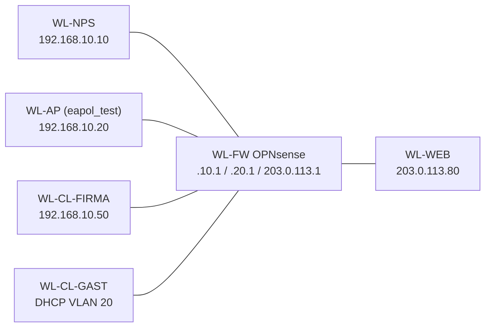

# 02.1 WLAN und Gästenetz mit Hyper-V, OPNsense und NPS

| | |
|---|---|
| **Modul** | 02 Hyper-V, OPNsense, NPS |
| **Stufe** | Aufbau bis Vertiefung |
| **Geschätzte Zeit** | 4 bis 6 Stunden (Schätzung) |
| **Werkzeuge** | Hyper-V, OPNsense, Windows Server (NPS), Windows-Client, Linux mit `eapol_test`, PowerShell |
| **Vorwissen** | Hyper-V-Grundlagen, VLAN-Begriff, Firewallregeln, Übung 01.1 (Packet Tracer) empfohlen |

> [!WARNING]
> **Stand der Prüfung: Entwurf.** OPNsense, NPS, Hyper-V und `eapol_test` wurden für dieses Dokument **nicht** ausgeführt. Die PowerShell-Skripte wurden nur mit nachgebauten Cmdlets getestet (`02.1-isolationstest.ps1` zusätzlich gegen echte lokale TCP-Ports). Menünamen von OPNsense und NPS stammen aus Dokumentation und Praxis und sind mit *nicht bestätigt* markiert, wo sie nicht gegen eine Quelle geprüft sind. Bitte nachbauen und Abweichungen melden.

> [!NOTE]
> **Kein Funk in dieser Übung.** Hyper-V-VMs haben keine WLAN-Hardware. Was mit Funk zu tun hat (Signal, Roaming, Client-Isolation im Access Point), kann hier nicht gezeigt werden. Gezeigt wird alles, was **hinter** dem Access Point passiert: Netztrennung, Firewallregeln, 802.1X-Anmeldung gegen RADIUS. Den Access Point und den Client spielt `eapol_test` (Teil von `wpa_supplicant`), das einen RADIUS-Zugriff wie ein Access Point auslöst.

## Lernziele

Nach dieser Übung kannst du

- ein Firmen- und ein Gästenetz auf Hyper-V mit VLANs und einer Firewall trennen,
- Firewallregeln für Gäste so schreiben, dass nur Internet und Namensauflösung erreichbar sind,
- einen NPS als RADIUS-Server für 802.1X (PEAP-MSCHAPv2) einrichten,
- eine Anmeldung ohne Funkgerät mit `eapol_test` auslösen und im Ereignisprotokoll nachvollziehen,
- mit einem Skript belegen, was ein Gast erreicht und was nicht, und erklären, warum der Test erst nach einem Vergleichslauf aussagekräftig ist,
- benennen, was in dieser Umgebung unbewiesen bleibt (Client-Isolation im Funk).

## Voraussetzungen

- Ein Windows-PC oder -Server mit Hyper-V und etwa 16 GB Arbeitsspeicher. Fünf bis sechs VMs laufen mit je 1 bis 2 GB.
- Installationsmedien: OPNsense (kostenlos), Windows Server (Testversion), Windows-Client, ein Linux (zum Beispiel Debian).
- Alles läuft auf **privaten Switches**. Es gibt keinen Zugang zum Heimnetz.
- Du hast Übung 01.1 gemacht oder kennst die Begriffe VLAN, Trunk, ACL.

## Topologie und Adressplan

<!-- tikz:topologie -->


| VM | Aufgabe | Switch | VLAN | Adresse |
|---|---|---|---|---|
| WL-FW | Firewall (OPNsense) | WAN: `sw-wlan-wan`, LAN: `sw-wlan-lab` | LAN-Adapter Trunk 10, 20 | WAN 203.0.113.1/24, VLAN 10: 192.168.10.1/24, VLAN 20: 192.168.20.1/24 |
| WL-NPS | RADIUS-Server (Windows Server) | `sw-wlan-lab` | 10 | 192.168.10.10/24, Gateway .10.1 |
| WL-AP | Access-Point-Ersatz (Linux, `eapol_test`) | `sw-wlan-lab` | 10 | 192.168.10.20/24, Gateway .10.1 |
| WL-CL-FIRMA | Firmen-Client (Windows) | `sw-wlan-lab` | 10 | 192.168.10.50/24, Gateway .10.1 |
| WL-CL-GAST | Gäste-Client (Windows) | `sw-wlan-lab` | 20 | DHCP aus 192.168.20.100 bis .199 |
| WL-WEB | „Internet“-Stellvertreter (Linux) | `sw-wlan-wan` | – | 203.0.113.80/24, Gateway 203.0.113.1 |

Die Domäne `alpenwerk.example` und der Bereich `203.0.113.0/24` sind für Beispiele reserviert und erfunden. Zugangsdaten sind Übungswerte.

## Aufgabe

### Teil 1: Das Netz trennen

**1. Switches und VMs anlegen**

- **GUI:** Hyper-V-Manager → *Virtueller Switch-Manager* → *Privat* → `sw-wlan-wan` und `sw-wlan-lab` anlegen. VMs erstellen (Namen laut Tabelle). WL-FW bekommt **zwei** Netzwerkadapter: der erste an `sw-wlan-wan`, der zweite bleibt zunächst ohne Switch. Auch WL-WEB hängt an `sw-wlan-wan`.
- **CLI:** (administrative PowerShell auf dem Host)

```powershell
New-VMSwitch -Name sw-wlan-wan -SwitchType Private
```

Den Switch `sw-wlan-lab` und die VLANs setzt das Skript in Schritt 2.

**2. VLANs an den VM-Adaptern setzen**

Das Skript legt `sw-wlan-lab` an, setzt den zweiten Adapter von WL-FW als Trunk für VLAN 10 und 20 und die Adapter der Clients als Access-Port.

- **GUI:** VM-Einstellungen → Netzwerkadapter → *Virtual-LAN-Kennung aktivieren* (nur ein VLAN je Adapter). Ein **Trunk** ist in der GUI nicht einstellbar (*nicht bestätigt*). Dafür das Skript oder den Befehl nehmen.
- **CLI:**

```powershell
.\02.1-hyperv-netz.ps1 -Modus Einrichten -WhatIf
.\02.1-hyperv-netz.ps1 -Modus Einrichten
Get-VMNetworkAdapterVlan -VMName WL-FW, WL-NPS, WL-CL-GAST
```

Erwartet (sinngemäß): WL-FW im Modus *Trunk* mit erlaubten VLANs `10,20`, WL-NPS und WL-AP und WL-CL-FIRMA im Modus *Access* mit VLAN 10, WL-CL-GAST mit VLAN 20.

**3. OPNsense installieren und Schnittstellen zuweisen**

- **GUI:** OPNsense-Installer starten, mit dem Konsolen-Konto installieren. In der Konsole: *Assign interfaces*. Der Adapter am `sw-wlan-wan` wird WAN. Der Trunk-Adapter wird LAN-Basis (Name im Gast zum Beispiel `hn1`, *nicht bestätigt*). **Reihenfolge der Adapter prüfen**, indem du MAC-Adressen im Hyper-V-Manager mit denen in OPNsense vergleichst.
- **CLI:** Entfällt, die Zuweisung geschieht in der OPNsense-Konsole.

Danach in der Weboberfläche (Adresse aus der Konsole, vom Firmen-Client im VLAN 10 aus erreichbar):

- *Interfaces* → *Other Types* → *VLAN*: VLAN-Tag 10 und 20 auf der Trunk-Schnittstelle (*nicht bestätigt*, Menüname).
- *Interfaces* → *Assignments*: beide VLANs zuweisen, aktivieren, Namen `FIRMA` und `GAST`, IPv4 statisch: 192.168.10.1/24 und 192.168.20.1/24.
- WAN: statisch 203.0.113.1/24. Für diese Übung bei WAN *Block private networks* und *Block bogon networks* ausschalten (*nicht bestätigt*, ob nötig). Das ist **nur** in dieser Laborumgebung vertretbar.
- *Services* → *DHCPv4* → `GAST`: Bereich 192.168.20.100 bis 192.168.20.199.
- *Services* → *Unbound DNS*: aktiv, Schnittstellen `FIRMA` und `GAST`.

**4. Zunächst alles erlauben und die Grundverbindung prüfen**

Damit der Test später etwas beweist, wird die Firewall zuerst **offen** gemacht.

- **GUI:** *Firewall* → *Rules* → `GAST`: eine Regel *Pass*, Protokoll *any*, Quelle `GAST net`, Ziel *any*. Dasselbe für `FIRMA`. Speichern, *Apply changes*.
- **CLI:** Entfällt, nur grafisch (oder über die Konfigurationsdatei, hier nicht beschrieben).

WL-CL-GAST soll eine Adresse aus 192.168.20.100 bis .199 bekommen. Prüfen im Client mit `ipconfig`. WL-WEB: `sudo python3 -m http.server 80` starten (Linux, im Ordner `/tmp`).

**5. Vergleichslauf: Was ist offen, solange die Firewall offen ist?**

Auf WL-CL-GAST das Skript `02.1-isolationstest.ps1` ausführen. Die Standardliste prüft sechs Ziele.

```powershell
.\02.1-isolationstest.ps1 -Ausgabe .\vorher.csv
```

Erwartet: Die Zeilen mit Erwartung *Gesperrt* zeigen **ABWEICHUNG**, weil die Dienste jetzt erreichbar sind. Genau das beweist, dass dahinter wirklich Dienste lauschen. Sieht eine Zeile „Gesperrt“ auch **ohne** Firewallregel, lauscht dort nichts, und der spätere Test sagt für dieses Ziel nichts aus. Dann den Dienst auf dem Ziel starten oder das Ziel im Skript ändern.

Ziele, die du für sinnvolle Aussagekraft prüfen musst: Firewall Web-Oberfläche (443), NPS Remotedesktop (3389, in Windows Server aktivieren), Firmen-Client SMB (445, Windows-Standard bei aktivierter Datei- und Druckerfreigabe).

**6. Gästeregeln in OPNsense**

OPNsense-Regeln sind zustandsbehaftet und werden von oben nach unten geprüft, die erste passende gilt. Alles, was nicht erlaubt ist, wird am Ende verworfen.

- **GUI:** *Firewall* → *Aliases* → neuer Alias `RFC1918`, Typ *Network(s)*: `10.0.0.0/8`, `172.16.0.0/12`, `192.168.0.0/16`. Dann *Firewall* → *Rules* → `GAST`, die offene Regel löschen und anlegen (Reihenfolge wichtig):
  1. *Pass*, TCP/UDP, Quelle `GAST net`, Ziel `GAST address`, Port `53` (DNS).
  2. *Pass*, IPv4 *any*, Quelle `GAST net`, Ziel `RFC1918` mit gesetztem Häkchen **Invert** (also alles außer privaten Adressen = „Internet“).
  3. *Block*, IPv4 *any*, Quelle `GAST net`, Ziel *any*, *Log* aktiv (damit man verworfene Verbindungen sieht).
- **CLI:** Entfällt, nur grafisch.

Falls der Gast-Client keine Adresse mehr bekommt: DHCP-Anfragen brauchen unter Umständen eine eigene Regel (UDP 68 nach 67). Ob OPNsense sie selbst zulässt, ist *nicht bestätigt*.

**7. Test nach den Regeln**

```powershell
.\02.1-isolationstest.ps1 -Ausgabe .\nachher.csv
```

Erwartet: alle sechs Zeilen *OK* (Rückgabewert 0). Zusätzlich im Browser des Gast-Clients `http://203.0.113.80` öffnen: die Seite des Python-Servers lädt. In OPNsense unter *Firewall* → *Log Files* → *Live View* siehst du die verworfenen Verbindungen der Gäste (rot/Block).

### Teil 2: Anmeldung mit 802.1X und NPS

**8. Windows Server vorbereiten**

WL-NPS: feste Adresse 192.168.10.10/24, Gateway 192.168.10.1, Name `WL-NPS`. Der Server bleibt **nicht in einer Domäne**: es genügt ein lokales Konto (siehe Hintergrund). Dann in einer administrativen PowerShell:

```powershell
.\02.1-nps-einrichten.ps1 -WhatIf
.\02.1-nps-einrichten.ps1
```

Das Skript installiert die NPS-Rolle, erstellt ein selbstsigniertes Zertifikat, legt das lokale Konto `wlan.test` an (Kennwort wird abgefragt) und trägt `WL-AP` (192.168.10.20) als RADIUS-Client ein (Geheimnis wird abgefragt, mindestens 12 Zeichen, ausdenken und notieren).

**9. Netzwerkrichtlinie in der NPS-Konsole**

Die Richtlinie lässt sich nicht per Skript anlegen (in dieser Übung nicht abgedeckt, *nicht bestätigt*, ob es dafür Cmdlets gibt).

- **GUI:** *Server-Manager* → *Tools* → *Netzwerkrichtlinienserver*. *Richtlinien* → *Netzwerkrichtlinien* → rechte Maustaste → *Neu*.
  - Name `WLAN-Firma`, Netzwerkzugriffsserver-Typ *Nicht angegeben*.
  - Bedingung: *NAS-Porttyp* = *Drahtlos – IEEE 802.11*.
  - Berechtigung: *Zugriff gewährt*.
  - Authentifizierungsmethode: *Microsoft: Geschütztes EAP (PEAP)* hinzufügen, *Bearbeiten*: das Zertifikat `nps.alpenwerk.example` wählen, EAP-Typ *Gesichertes Kennwort (EAP-MSCHAP v2)*. Alle anderen (unverschlüsselte) Methoden **abwählen**.
  - Fertig stellen.
- **CLI:** Entfällt, nur grafisch.

Die Menünamen stammen aus der Windows-Server-Praxis (deutsche Oberfläche) und sind *nicht bestätigt*.

**10. eapol_test auf WL-AP**

`eapol_test` gehört zu `wpa_supplicant`. In Debian gibt es dafür ein eigenes Paket `eapoltest` (*nicht bestätigt*), sonst wird es aus den Quellen von `hostap` mit `CONFIG_EAPOL_TEST=y` gebaut. Kopiere `02.1-eapol-test.conf` auf WL-AP und trage das Testkennwort ein (Datei danach mit `chmod 600` schützen).

```bash
eapol_test -c 02.1-eapol-test.conf -a 192.168.10.10 -p 1812 -s 'DAS-RADIUS-GEHEIMNIS' -A 192.168.10.20 -N 61:d:19
```

Das Geheimnis steht hier in der Befehlszeile und bleibt damit in der Verlaufsdatei der Shell. Für die Übung geht das, in der Praxis nicht.

Erwartet (sinngemäß): Am Ende steht `SUCCESS`. Bei falschem Kennwort steht `FAILURE`.

**11. Gegenprobe: Was steht im Protokoll?**

- **GUI, auf WL-NPS:** *Ereignisanzeige* → *Windows-Protokolle* → *Sicherheit*. Filter auf die Ereignis-IDs **6272** (Zugriff gewährt) und **6273** (Zugriff verweigert). Öffne das Ereignis und lies *Benutzername*, *Client-IP-Adresse*, *Netzwerkrichtlinienname* und bei Ablehnung den *Grund*.
- **CLI:**

```powershell
Get-WinEvent -FilterHashtable @{ LogName = 'Security'; Id = 6272, 6273 } -MaxEvents 10 |
    Select-Object TimeCreated, Id, @{ n = 'Text'; e = { ($_.Message -split "`r?`n")[0] } }
```

Erwartet: Ein Ereignis 6272 für den erfolgreichen Lauf, ein 6273 für den Lauf mit falschem Kennwort.

### Teil 3: Prüfen und Betrieb

**12. Drei Fehlerfälle gezielt auslösen**

Löse jeden Fall einzeln aus, lies die Meldung und stelle den Ausgangszustand wieder her.

| Fall | So auslösen | Erwartung (sinngemäß) |
|---|---|---|
| Falsches Geheimnis | `-s` in `eapol_test` ändern | Keine Antwort, die Anfrage wird stillschweigend verworfen. Im NPS-Protokoll steht eventuell ein Ereignis zu einer ungültigen Nachricht (*nicht bestätigt*). |
| Falsches Kennwort | Kennwort in der Konfigurationsdatei ändern | `FAILURE`, Ereignis 6273 mit Grund zur Authentifizierung. |
| Konto gesperrt | `Disable-LocalUser wlan.test` | `FAILURE`, Ereignis 6273 mit Grund zum deaktivierten Konto. Danach `Enable-LocalUser wlan.test`. |

**13. Verwaltung absichern**

Die Weboberfläche der Firewall darf für Gäste nicht erreichbar sein (siehe Test). Zusätzlich:

- *System* → *Settings* → *Administration*: Zugriff auf die Weboberfläche nur auf der Schnittstelle `FIRMA` (*nicht bestätigt*, Menüname).
- *System* → *Configuration* → *Backups*: Konfiguration herunterladen und aufbewahren. Die Datei enthält Geheimnisse, also geschützt ablegen.

**14. Betriebsregeln für ein echtes Gäste-WLAN (Diskussion)**

- Das Gästekennwort regelmäßig tauschen, am besten zeitgesteuert, und nicht per E-Mail an alle verschicken.
- Protokolle der Firewall und des NPS gehören regelmäßig angesehen. Ohne Auswertung nützt Protokollieren nichts.
- Gäste bekommen **keine** Konten im Firmenverzeichnis.
- Geräte-Updates: Der Access Point und die Firewall brauchen einen Wartungsplan.

## Hintergrund: Was passiert im Netzwerk?

### Warum der Test erst im Vergleich etwas beweist

Eine geschlossene Tür und eine Wand sehen von außen gleich aus. Ein TCP-Versuch auf einen Port, an dem nichts lauscht, scheitert genauso wie einer, den eine Firewall verwirft. Erst wenn das Ziel **ohne** Regel erreichbar ist und **mit** Regel nicht, hat die Regel gewirkt. Deshalb Schritt 5 vor Schritt 7.

### Zustandsbehaftete Regeln gegenüber der ACL aus Übung 01.1

OPNsense merkt sich aufgebaute Verbindungen. Eine Antwort auf eine erlaubte Anfrage passiert, ohne dass eine eigene Regel dafür nötig ist. Dadurch entfällt das Problem der zustandslosen ACL aus der Packet-Tracer-Übung.

### Warum „alles außer privaten Adressen“

Das Gästenetz soll ins Internet, aber nirgends ins Firmennetz. Statt jedes interne Netz einzeln zu sperren, wird das Ziel auf „nicht privat“ begrenzt. Ein neues internes Netz ist damit automatisch geschützt. Die Ausnahme DNS an die Firewall selbst steht vorher, weil die Firewall eine private Adresse ist.

### Wie 802.1X abläuft

Der Client (Supplicant) spricht über den Access Point (Authenticator) mit dem RADIUS-Server. Der Server weist sich mit einem Zertifikat aus, der Client schickt im geschützten Tunnel (PEAP) Benutzername und Kennwort (MSCHAPv2). Der Access Point leitet nur durch und kennt das Kennwort nicht. Zwischen Access Point und NPS schützt das gemeinsame Geheimnis die Nachrichten. `eapol_test` übernimmt beide Rollen, Supplicant und Authenticator, und spricht RADIUS direkt mit dem NPS.

### Warum der Server nicht in der Domäne sein muss

NPS kann Konten des eigenen Servers prüfen. Das genügt für den Nachweis des Ablaufs. In einer Firma prüft NPS gegen das Active Directory. Dann kommt die Richtlinie über eine Gruppenmitgliedschaft (zum Beispiel `WLAN-Benutzer`) und nicht über ein einzelnes Konto.

### Was in dieser Übung nicht bewiesen wird

- **Client-Isolation** (Gäste-Geräte sehen einander nicht): Das ist eine Funktion des Access Points im Funknetz. In Hyper-V gibt es für VMs auf demselben Switch die Möglichkeit privater VLANs (`Set-VMNetworkAdapterVlan -Isolated`, *nicht bestätigt*), die das ähnlich nachbilden. Das wäre eine Erweiterung und kein Beweis für den Access Point.
- **Zertifikatsprüfung am Client:** Die Konfiguration prüft das Zertifikat des NPS **nicht**. Ein echtes Netz muss das tun, sonst kann ein gefälschter Access Point Anmeldungen abgreifen.

## Hinweise

- Alle VMs gehören in die Testumgebung. Nichts davon in einem Firmen- oder Heimnetz ausprobieren.
- Das RADIUS-Geheimnis muss auf beiden Seiten gleich sein. Der häufigste Fehler ist ein Tippfehler.
- Wenn `eapol_test` nichts ausgibt: Die Windows-Firewall auf WL-NPS muss UDP 1812 zulassen (die NPS-Installation richtet das laut Praxis selbst ein, *nicht bestätigt*), und die OPNsense-Regeln auf `FIRMA` dürfen den Verkehr zwischen WL-AP und WL-NPS nicht blockieren (beide im selben VLAN, also nicht über die Firewall).
- Speichere vor jedem größeren Schritt einen Prüfpunkt der VMs.

## Prüfbefehle

| Aufgabe | Befehl | GUI-Weg |
|---|---|---|
| VLAN-Zuordnung | `Get-VMNetworkAdapterVlan -VMName WL-FW` | VM-Einstellungen → Netzwerkadapter |
| Adresse am Gast | `ipconfig` | Netzwerkeinstellungen |
| Gästetest | `.\02.1-isolationstest.ps1` | – |
| Verworfene Verbindungen | – | OPNsense → *Firewall* → *Log Files* → *Live View* |
| Anmeldeereignisse | `Get-WinEvent` mit Ids 6272, 6273 | Ereignisanzeige → Sicherheit |
| RADIUS-Test | `eapol_test` (Schritt 10) | – |

**Kontrollfragen**

1. Warum läuft der Vergleichslauf mit offener Firewall vor dem eigentlichen Test?
2. Warum steht die DNS-Regel vor der Regel „alles außer privaten Adressen“?
3. Wer kennt das Kennwort des Benutzers: Access Point, RADIUS-Server oder beide?
4. Wozu dient das gemeinsame Geheimnis zwischen Access Point und NPS?
5. Welche Sicherheitslücke entsteht, wenn der Client das Zertifikat des Servers nicht prüft?
6. Was kann diese Umgebung über Client-Isolation nicht aussagen?

## Erweiterungen

- Traffic Shaping je Gast in OPNsense (*Firewall* → *Shaper*: Pipe mit Bandbreite, Maske „Destination“ bzw. „Source“ für eine Begrenzung je Adresse, *nicht bestätigt*) und Messung mit `iperf3`.
- Captive Portal mit Gutscheinen (*Services* → *Captive Portal*, Zone für `GAST`, Authentifizierung über Gutscheine, *nicht bestätigt*).
- Server in die Domäne aufnehmen und die Richtlinie über eine AD-Gruppe steuern (Übung zur Benutzerverwaltung).
- Private VLANs in Hyper-V für eine Nachbildung der Client-Isolation.

## Musterlösung

<details>
<summary>Musterlösung anzeigen</summary>

### Erwartete Zustände

| Schritt | Erwartung |
|---|---|
| 2 | WL-FW: Trunk mit `10,20`. Clients: Access mit 10 bzw. 20. |
| 5 | Vorher: Zeilen mit Erwartung *Gesperrt* zeigen ABWEICHUNG (Dienste lauschen), Rückgabewert 1. |
| 7 | Nachher: sechs Zeilen *OK*, Rückgabewert 0. Webseite des Internet-Stellvertreters lädt. |
| 10 | `SUCCESS` bei richtigem Kennwort. |
| 11 | Ereignis 6272 für den erfolgreichen Lauf. |
| 12 | `FAILURE` und Ereignis 6273 bei falschem Kennwort und bei gesperrtem Konto. |

### Antworten auf die Kontrollfragen

1. Nur wenn das Ziel ohne Regel erreichbar ist, beweist ein „Gesperrt“ danach die Wirkung der Regel.
2. Die Firewall hat eine private Adresse. Ohne die vorgezogene Ausnahme würde die Regel „alles außer privat“ DNS nicht erfassen, und der Block am Ende würde Namensauflösung verhindern.
3. Nur der RADIUS-Server prüft das Kennwort. Der Access Point leitet den geschützten Tunnel durch.
4. Es weist den Access Point beim Server aus und schützt die RADIUS-Nachrichten. Ohne das richtige Geheimnis verwirft der Server die Anfrage.
5. Ein gefälschter Access Point mit eigenem Zertifikat kann Anmeldungen entgegennehmen und Kennwort-Prüfsummen mitschneiden.
6. Alles, was im Funk passiert: Isolation der Gäste untereinander im Access Point, Signalstärke, Roaming.

</details>

## Quellen

Stand der Abfrage: 2026-11-06.

- Microsoft Learn: Dokumentation zu Netzwerkrichtlinienserver (NPS), Hyper-V (`Set-VMNetworkAdapterVlan`) und `New-SelfSignedCertificate`. Dienten zur Prüfung von Cmdlets und Konzepten.
- OPNsense-Dokumentation (docs.opnsense.org): Firewallregeln, Aliase, Traffic Shaping, Captive Portal.
- `wpa_supplicant`/`hostap` (w1.fi): `eapol_test`.

**Nicht gegen eine Quelle geprüft** (aus eigener Kenntnis, bitte gegenprüfen): alle Menünamen in OPNsense und im deutschen NPS, die Ereignistexte der Ereignisse 6272/6273, die Ausgabe `SUCCESS`/`FAILURE` von `eapol_test`, das Verhalten von OPNsense bei DHCP-Anfragen, die Paketverfügbarkeit von `eapol_test` in Debian.

---
Lizenz: Dieses Dokument steht unter [CC BY-NC-SA 4.0](https://creativecommons.org/licenses/by-nc-sa/4.0/deed.de), Urheber AnsibleArtisan4711. Die Skripte stehen unter der MIT-Lizenz. OPNsense, Microsoft, Windows, Hyper-V und Debian sind Marken ihrer Inhaber. Dieses Dokument ist nicht mit diesen Unternehmen verbunden.
